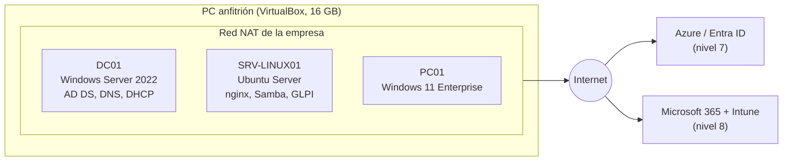

# Costa Brava Corp: la IT de una pyme, montada desde cero

Homelab en el que hago de único informático de una empresa ficticia y monto su
infraestructura nivel a nivel: directorio activo, Linux, service desk, monitorización,
backups, automatización, nube, Microsoft 365 y seguridad.

## La empresa

**Costa Brava Corp** es una distribuidora de material de hostelería con sede en Blanes.
Tiene 30 empleados en una sola oficina:

| Departamento   | Personas |
|----------------|---------:|
| Dirección      | 3        |
| Administración | 6        |
| Ventas         | 10       |
| Almacén        | 10       |
| IT             | 1 (yo)   |

Cada nivel arranca con peticiones realistas de empleados o de Dirección, tratadas como tickets.
Los datos definitivos se confirman en el nivel 0.

## Diagrama

Versión inicial. El plan de IPs y los nombres definitivos se diseñan en el nivel 0
(ver `docs/diagramas/`).



## Niveles

| Nivel | Tema | Estado |
|------:|------|--------|
| 0 | Diseño de la empresa (sin VMs) | Pendiente |
| 1 | La oficina abre: AD, DNS, DHCP y GPO | Pendiente |
| 2 | Llegan los Linux: Ubuntu Server, nginx, Samba | Pendiente |
| 3 | Service desk con GLPI | Pendiente |
| 4 | Monitorización con Zabbix y Grafana | Pendiente |
| 5 | Backups con Veeam Community Edition | Pendiente |
| 6 | Automatización con PowerShell y Ansible | Pendiente |
| 7 | Nube: Entra ID, Azure y Terraform | Pendiente |
| 8 | Microsoft 365 e Intune | Pendiente |
| 9 | Seguridad y simulacro de ransomware con Wazuh | Pendiente |

## Estructura del repositorio

```
CLAUDE.md          Reglas del mentor (Claude Code) para este proyecto
dashboard/         Web local: chat con el mentor y panel de progreso
docs/PROGRESS.md   Hecho / En curso / Siguiente / Dudas
docs/plans/        Plan de cada nivel, escrito antes de empezarlo
docs/diagramas/    Diagramas en Mermaid
docs/inventario.md Inventario de equipos, IPs y servicios
niveles/           Documentación, scripts y capturas de cada nivel
```

## Reglas del laboratorio

- Coste 0 €: solo evaluaciones y niveles gratuitos; cualquier recurso cloud con presupuesto y alerta.
- Ninguna contraseña ni identificador real en el repositorio.
- Snapshot antes de cada cambio importante.
