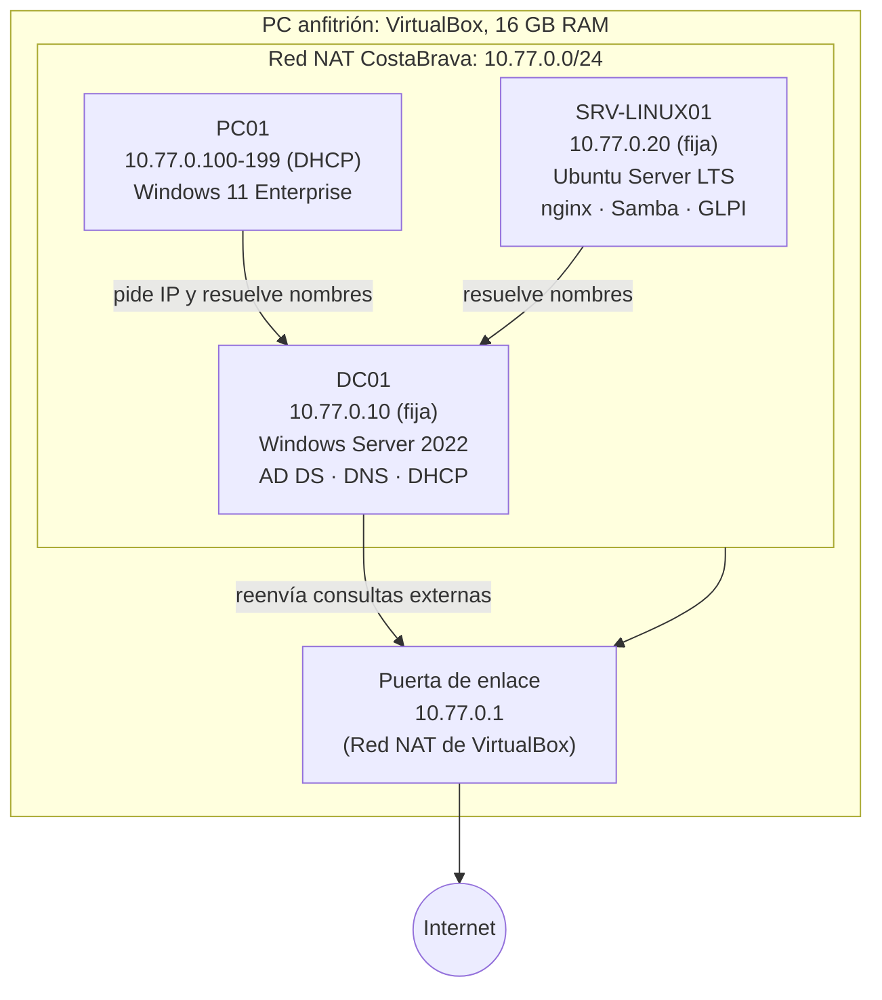

# Red de Costa Brava Corp: nivel 0 (diseño)

Red prevista antes de crear ninguna VM. Detalle de las decisiones en
[`niveles/nivel-0/diseno.md`](../../niveles/nivel-0/diseno.md).

## Cómo leerlo

- Las tres VMs están dentro de la **Red NAT** `10.77.0.0/24`: se ven entre ellas, pero desde fuera del PC no se ve ninguna.
- **DC01** es el centro: da las IPs a los PCs (DHCP) y resuelve los nombres del dominio (DNS). Los nombres de internet los reenvía hacia fuera.
- **SRV-LINUX01** y **DC01** tienen IP fija: si cambiara, nadie los encontraría.
- **PC01** recibe una IP del rango `.100-.199` cada vez que arranca.
- La salida a internet pasa por la puerta de enlace `10.77.0.1`, que pone VirtualBox.

## Reparto de IPs

| IP / rango | Uso |
|------------|-----|
| 10.77.0.1 | Puerta de enlace |
| 10.77.0.10 | DC01 |
| 10.77.0.20 | SRV-LINUX01 |
| 10.77.0.21 - .49 | Servidores futuros |
| 10.77.0.50 - .99 | Impresoras y dispositivos |
| 10.77.0.100 - .199 | DHCP para PCs |
| 10.77.0.200 - .254 | Reserva |
